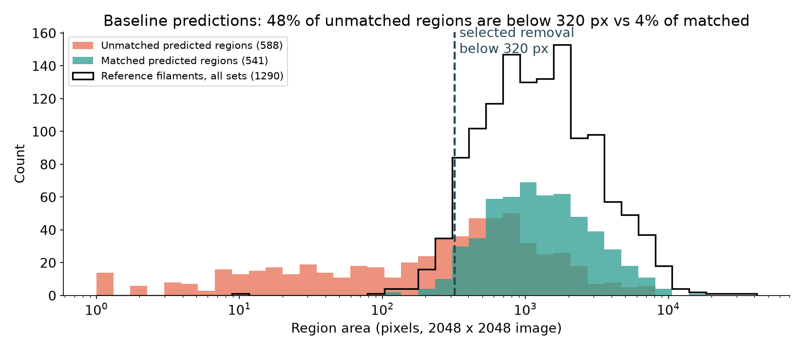
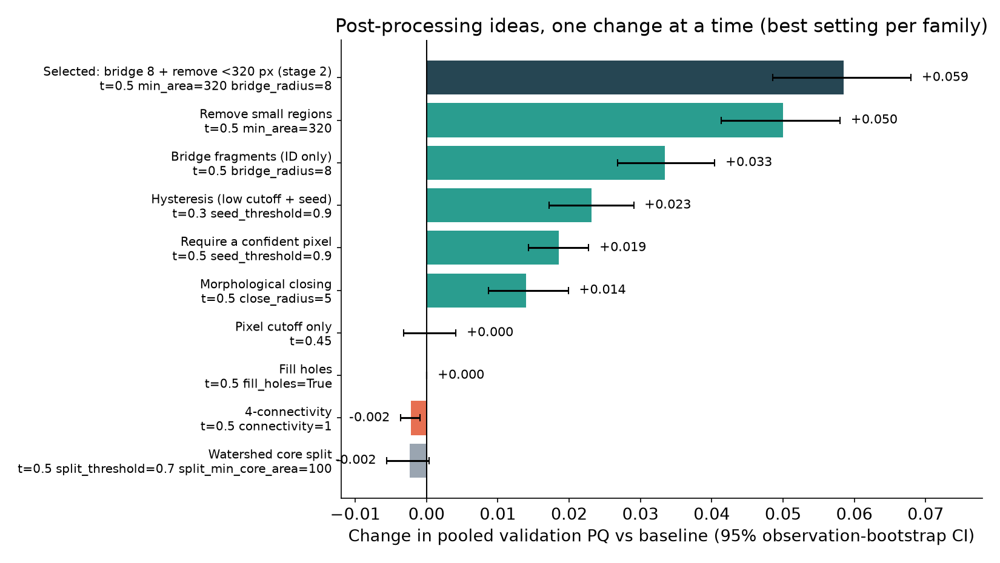
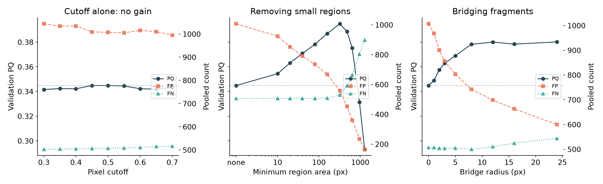
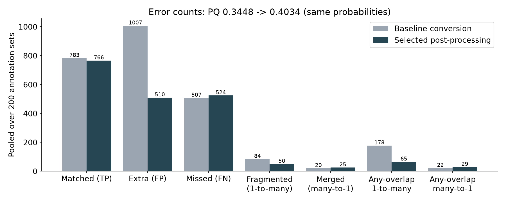
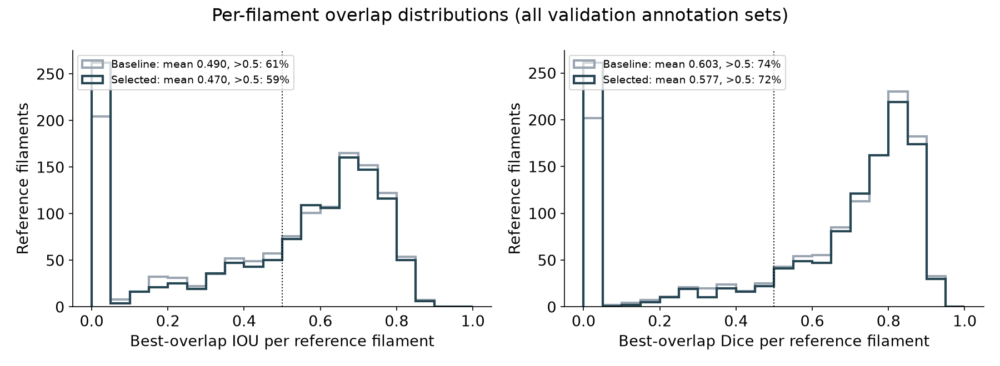
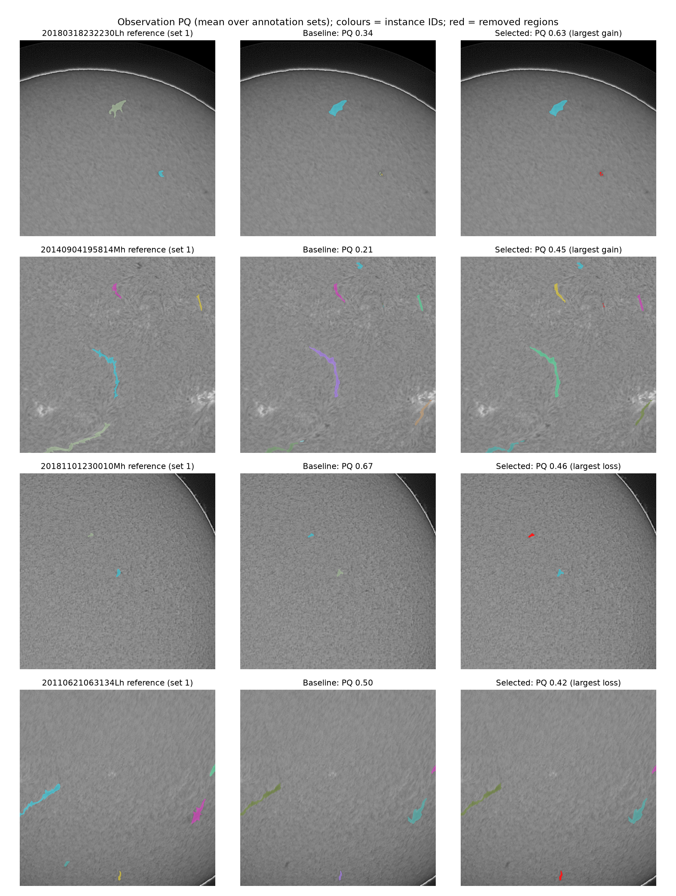
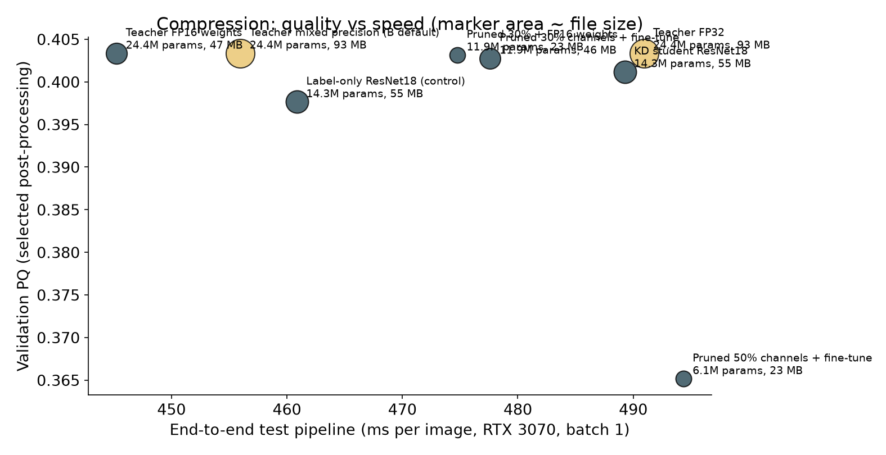
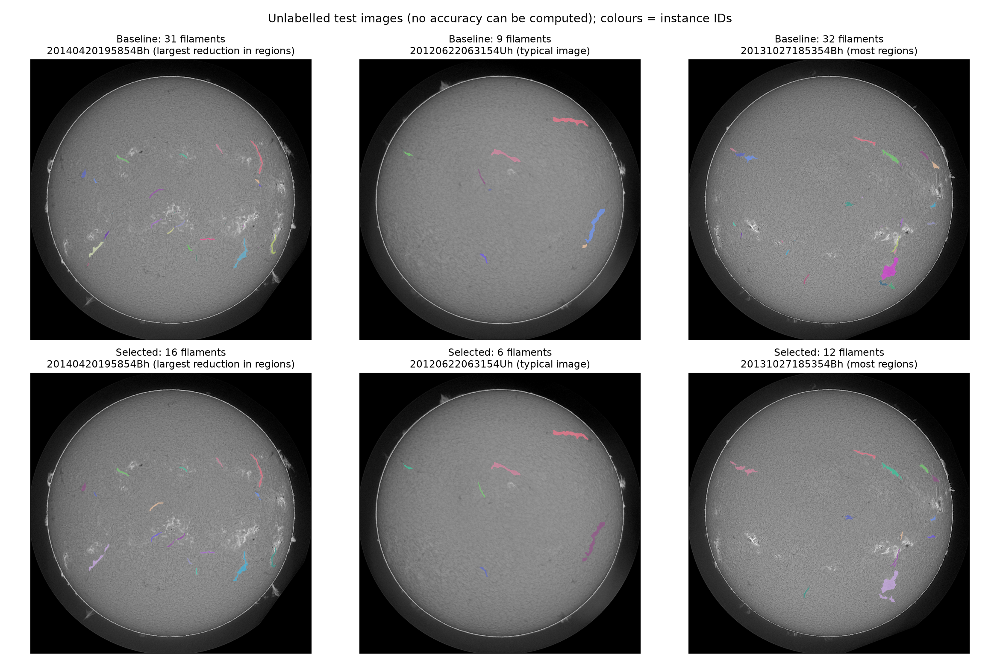

# Person C: instance post-processing, compression and final submission

Generated by `person_c_report.py` from recorded run outputs; nothing here was retrained or re-scored by the report itself. All validation numbers use the frozen split (122 images, 200 annotation sets), pooled `PQ_dataset` and strict IoU > 0.5 matching, exactly as in Person B's study.

## In plain language

* Person B's seed-45 model turns each image into a probability map. The baseline turned that map into filaments by keeping pixels above 0.5 and calling each connected blob one filament (PQ 0.3448).
* Most errors were **extra small blobs**: 1,007 unmatched predictions against 507 misses. 48% of unmatched blobs are smaller than 320 pixels, but only 4% of correctly matched blobs and 5% of human-drawn filaments are that small.
* The selected post-processing first gives fragments separated by at most 16 pixels one shared ID (no pixels added), then removes blobs under 320 pixels. Validation PQ rises to **0.4034** (+0.0585; 95% observation-bootstrap interval +0.0486 to +0.0679). Tuning on one half of the validation time blocks and testing on the other half gave gains of +0.0592 and +0.0557.
* Cost: 17 fewer matched filaments (small real ones) and merges 20 → 25; benefit: extra blobs 1,007 → 510 and fragmentation 84 → 50.
* Changing only the pixel cutoff, watershed splitting, flip test-time augmentation, hole filling and 4-connectivity did not help (details below).
* Final deployed model: Pruned 30% + FP16 weights (11.93 M parameters, 22.9 MB weights file); end-to-end 475 ms/image over 180 test images (476 ms excluding the first), RTX 3070; 1421 filaments on 180 test images. FP16 weights: PQ change -0.00001 at 47 vs 93 MB; distillation 0.401 vs label-only 0.398 (ResNet18, 14.3 M params); 50% channel pruning 0.365 (6.1 M params); 30% channel pruning 0.403 (11.9 M params). Chosen by the declared rule: Pruned 30% + FP16 weights.

## 1. Offline runner and reproduction check

`offline_eval.py` re-scores saved probability archives with `evaluate.score_observation`, the same per-annotation-set function now used by `evaluate.py` (including original layers for overlapping or empty annotations). With the baseline conversion it reproduced Person B's recorded summary (`PQ_dataset` 0.3448101728178549, TP 783, FP 1007, FN 507) to 1e-12 on every checked key, and its recomputed instance maps were identical to all 122 archived maps (reference check: True). Re-running the checkpoint on this RTX 3070 gave PQ 0.34492 (TP 783, FP 1006, FN 507): an expected small mixed-precision hardware difference.

## 2. Where the errors were



## 3. Post-processing study

Stage 1 (55 settings, `configs/person_c/pp_stage1.yaml`) changed one thing at a time. Intervals are paired 95% bootstrap intervals over validation observations (2,000 resamples).

| Family | Best setting | PQ | ΔPQ | 95% CI | TP | FP | FN | 1-to-many | many-to-1 |
|---|---:|---:|---:|---:|---:|---:|---:|---:|---:|
| Remove small regions | t=0.5 min_area=320 | 0.3948 | +0.0500 | [+0.0413, +0.0580] | 759 | 559 | 531 | 73 | 20 |
| Bridge fragments (ID only) | t=0.5 bridge_radius=8 | 0.3782 | +0.0334 | [+0.0268, +0.0404] | 790 | 742 | 500 | 56 | 25 |
| Hysteresis (low cutoff + seed) | t=0.3 seed_threshold=0.9 | 0.3680 | +0.0232 | [+0.0172, +0.0291] | 787 | 820 | 503 | 80 | 19 |
| Require a confident pixel | t=0.5 seed_threshold=0.9 | 0.3633 | +0.0185 | [+0.0143, +0.0228] | 783 | 850 | 507 | 84 | 20 |
| Morphological closing | t=0.5 close_radius=5 | 0.3588 | +0.0140 | [+0.0087, +0.0199] | 785 | 884 | 505 | 72 | 22 |
| Pixel cutoff only | t=0.45 | 0.3448 | +0.0000 | [-0.0032, +0.0041] | 784 | 1009 | 506 | 82 | 20 |
| Fill holes | t=0.5 fill_holes=True | 0.3448 | +0.0000 | [-0.0000, +0.0001] | 783 | 1007 | 507 | 84 | 20 |
| 4-connectivity | t=0.5 connectivity=1 | 0.3426 | -0.0022 | [-0.0037, -0.0009] | 783 | 1026 | 507 | 86 | 20 |
| Watershed core split | t=0.5 split_threshold=0.7 split_min_core_area=100 | 0.3425 | -0.0024 | [-0.0056, +0.0004] | 782 | 1023 | 508 | 93 | 18 |





Stage 2 (50 settings, `configs/person_c/pp_stage2.yaml`) was declared after stage 1: it extended the two settings that peaked at the grid edge and combined the helpful steps. Top ten:

| Setting | PQ | ΔPQ | 95% CI | TP | FP | FN |
|---|---:|---:|---:|---:|---:|---:|
| t=0.4 seed_threshold=0.9 min_area=320 bridge_radius=8 | 0.4039 | +0.0591 | [+0.0487, +0.0687] | 767 | 508 | 523 |
| t=0.5 min_area=320 bridge_radius=8 | 0.4034 | +0.0585 | [+0.0486, +0.0679] | 766 | 510 | 524 |
| t=0.4 seed_threshold=0.9 min_area=320 bridge_radius=12 | 0.4033 | +0.0585 | [+0.0475, +0.0691] | 760 | 492 | 530 |
| t=0.5 seed_threshold=0.9 min_area=320 bridge_radius=8 | 0.4029 | +0.0581 | [+0.0483, +0.0675] | 765 | 511 | 525 |
| t=0.5 min_area=320 bridge_radius=12 | 0.4021 | +0.0573 | [+0.0459, +0.0680] | 757 | 493 | 533 |
| t=0.5 seed_threshold=0.9 min_area=320 bridge_radius=12 | 0.4016 | +0.0568 | [+0.0457, +0.0674] | 756 | 494 | 534 |
| t=0.4 seed_threshold=0.9 min_area=320 bridge_radius=5 | 0.4011 | +0.0563 | [+0.0467, +0.0655] | 765 | 525 | 525 |
| t=0.5 seed_threshold=0.9 min_area=320 bridge_radius=5 | 0.3999 | +0.0551 | [+0.0452, +0.0643] | 762 | 526 | 528 |
| t=0.5 min_area=320 bridge_radius=5 | 0.3998 | +0.0550 | [+0.0452, +0.0642] | 761 | 525 | 529 |
| t=0.5 min_area=160 bridge_radius=8 | 0.3994 | +0.0546 | [+0.0463, +0.0631] | 788 | 589 | 502 |

**Selection.** The four-step best setting and the two-step `bridge_radius=8, min_area=320` setting differ by 0.0005 PQ (paired 95% interval about -0.003 to +0.004), so the simpler two-step rule was selected. It was also the setting chosen when tuning on half A of the validation blocks; tested on the held-out halves the gains were +0.0592 and +0.0557. With this rule PQ is flat for pixel cutoffs 0.35 to 0.55 (0.403 to 0.405), so the result does not hinge on the cutoff.







### Negative results

* **Pixel cutoff alone** (0.3 to 0.7): no setting beat 0.5. Lowering it to 0.3 recovered only 4 matches while adding 37 unmatched regions, so most misses are not simply faint pixels below 0.5.
* **Watershed split at confident cores**: -0.002 to -0.010 PQ. Single filaments have uneven confidence and were cut into pieces (fragmentation up to 104), while merges were rare (20).
* **Fill holes**: no effect; **4-connectivity**: -0.002.
* **Flip test-time augmentation** (`configs/person_c/seed45_tta.yaml`): baseline conversion 0.3372 vs 0.3449 without TTA on the same GPU; with the selected post-processing 0.3995 vs 0.4034. Even choosing each side's best cutoff afterwards, TTA gained only +0.0007, at 3.8x the model inference time (382 vs 99 ms per validation image). Not adopted.

## 4. Compression study

All variants were scored on the same validation split with the selected post-processing and timed with the complete image-to-CSV test pipeline (`predict.predict_test`, 180 images, batch 1, model loading excluded, first image included) on one RTX 3070, one variant at a time. Students used Person B's recipe (random foreground-biased 512 crops, AdamW 3e-4, cosine schedule, mixed precision, 20 epochs, seed 45) and kept the best validation epoch. The distilled student's loss is 0.5 x (BCE + Dice with labels) + 0.5 x BCE with the teacher's probabilities; the label-only control uses the identical code path with distillation weight 0. Pruning removed the lowest-L1 channels uniformly in every layer (torch-pruning dependency graph, segmentation head output kept) and then fine-tuned for 10 epochs: learning rate 1e-4 for the declared 50% run, which predicted nothing until its last epoch, and 3e-4 for the follow-up 30% run. The 30% run and its FP16 copy were added after the first results and evaluated under the unchanged final-model rule. CPU variants were re-timed in a quiet window because the first CPU timings overlapped slide rendering (the first runs are kept under `runs/person_c/compression/superseded/`). ONNX FP32 matched PyTorch probabilities to 6e-6; INT8 (static QDQ, per-channel weights) was calibrated on 8 training images only.

| Variant | Device | Parameters | File | Val PQ (baseline conversion) | Val PQ (selected) | ms / image | Training |
|---|---:|---:|---:|---:|---:|---:|---:|
| Teacher FP32 | GPU (RTX 3070) | 24.43 M | 93.4 MB | 0.3443 | 0.4034 | 491 | - |
| Teacher mixed precision (B default) | GPU (RTX 3070) | 24.43 M | 93.4 MB | 0.3449 | 0.4034 | 456 | - |
| Teacher FP16 weights | GPU (RTX 3070) | 24.43 M | 46.7 MB | 0.3450 | 0.4033 | 445 | - |
| KD student ResNet18 | GPU (RTX 3070) | 14.32 M | 54.7 MB | 0.3279 | 0.4012 | 489 | 11.1 min |
| Label-only ResNet18 (control) | GPU (RTX 3070) | 14.32 M | 54.7 MB | 0.3368 | 0.3976 | 461 | 8.3 min |
| Pruned 50% channels + fine-tune | GPU (RTX 3070) | 6.11 M | 23.5 MB | 0.2809 | 0.3652 | 494 | 4.4 min |
| Pruned 30% channels + fine-tune | GPU (RTX 3070) | 11.93 M | 45.7 MB | 0.3279 | 0.4028 | 478 | 4.0 min |
| Pruned 30% + FP16 weights | GPU (RTX 3070) | 11.93 M | 22.9 MB | 0.3288 | 0.4031 | 475 | 4.0 min |
| CPU: PyTorch FP32 | CPU | 24.43 M | 93.4 MB | - | - | 2463 (20 imgs) | - |
| CPU: ONNX Runtime FP32 | CPU | 24.43 M | 93.2 MB | - | - | 1691 (20 imgs) | - |
| CPU: ONNX Runtime INT8 | CPU | 24.43 M | 23.6 MB | 0.3447 | 0.4068 | 1158 (20 imgs) | - |

GPU timings cover all 180 test images; CPU timings cover the first test images only (shown), so compare CPU rows only with each other.



## 5. Final pipeline and submission

Rule (declared before benchmarks, `results/person_c/final_selection_rule.json`): Among the benchmarked variants, all scored with the selected post-processing on the unchanged validation split on the same RTX 3070, choose the smallest deployable file whose validation PQ_dataset is within 0.002 of the uncompressed teacher (seed-45 weights, mixed-precision inference). Ties: the faster end-to-end test pipeline. If no compressed variant qualifies, keep the teacher. The 30% pruned variants were benchmarked after the rule was declared; the rule itself was not changed. The FP16 teacher (46.7 MB, PQ 0.4033) is an essentially equivalent alternative.

| Item | Value |
|---|---:|
| Chosen variant | Pruned 30% + FP16 weights |
| Size | 11.93 M parameters, 22.9 MB weights file |
| Training time | 12.4 min teacher training loop (20 epochs, RTX 5060 Ti) + 4.0 min fine-tuning after pruning (RTX 3070) |
| Validation PQ | 0.4031 (selected post-processing; baseline conversion 0.3288) |
| End-to-end inference | 475 ms/image over 180 test images (476 ms excluding the first), RTX 3070 |
| Test CSV | 1421 filaments, 180 images, 3 without detections |
| CSV SHA256 | 1b08bcb078b2a44ad9e64545490c875b5c0fb01db87a1b34c2570825a5e9fb2f |
| Independent CSV check | `results/person_c/final_submission_check.json`: every RLE decodes to a non-empty 2048 x 2048 mask, IDs unique, no overlaps |
| Kaggle | Not uploaded by this work; record the score after the team's upload. |



## 6. Limitations

* All tuning used the single frozen validation split; the split-half and bootstrap checks reduce but do not remove selection optimism, and Kaggle uses different images.
* Post-processing was tuned on one representative model (seed 45). Its effect on other seeds was not measured because their probabilities were not transferred.
* Compression variants were trained once (seed 45); differences between them are single-run results.
* Timings are single passes on one RTX 3070 and differ from Person B's RTX 5060 Ti numbers.

## 7. Reproduce

Run from the repository root after adding the data and Person B's package (README). Training and timing commands use the GPU; run them one at a time.

```powershell
$py = '.\.venv\Scripts\python.exe'
# Checkpoint inference on this GPU (reference) and flip test-time augmentation
& $py evaluate.py --checkpoint runs/person_b_final/best_weights.pt --config runs/person_b_final/config.yaml --output runs/person_c/reproduced_evaluation --save-predictions
& $py evaluate.py --checkpoint runs/person_b_final/best_weights.pt --config configs/person_c/seed45_tta.yaml --output runs/person_c/tta_evaluation --save-predictions
# Offline scoring: exact baseline reproduction, declared sweeps, selected setting, TTA check
& $py offline_eval.py score --predictions runs/person_b_final/evaluation/predictions --config configs/person_c/seed45_selected.yaml --output runs/person_c/offline_baseline --expect runs/person_b_final/evaluation/summary.json --check-stored
& $py offline_eval.py sweep --predictions runs/person_b_final/evaluation/predictions --config configs/person_c/seed45_selected.yaml --grid configs/person_c/pp_stage1.yaml --output runs/person_c/pp_stage1
& $py offline_eval.py sweep --predictions runs/person_b_final/evaluation/predictions --config configs/person_c/seed45_selected.yaml --grid configs/person_c/pp_stage2.yaml --output runs/person_c/pp_stage2
& $py offline_eval.py score --predictions runs/person_b_final/evaluation/predictions --config configs/person_c/final_postprocess.yaml --output runs/person_c/offline_final
& $py offline_eval.py sweep --predictions runs/person_c/tta_evaluation/predictions --config configs/person_c/seed45_selected.yaml --grid configs/person_c/pp_check.yaml --output runs/person_c/pp_check_tta
& $py offline_eval.py sweep --predictions runs/person_c/reproduced_evaluation/predictions --config configs/person_c/seed45_selected.yaml --grid configs/person_c/pp_check.yaml --output runs/person_c/pp_check_no_tta_same_gpu
# Compression: distilled student, then the queued jobs (control, pruning, FP16, ONNX/INT8, benchmarks)
& $py compress.py distill --teacher runs/person_b_final/best_weights.pt --config configs/person_c/seed45_selected.yaml --output runs/person_c/compression/kd_resnet18 --name kd_resnet18_seed45 --encoder resnet18 --kd-weight 0.5 --validate-from 11
powershell -ExecutionPolicy Bypass -File jobs/person_c/1_gpu_compression_queue.ps1
powershell -ExecutionPolicy Bypass -File jobs/person_c/2_pruning30_and_cpu_queue.ps1
powershell -ExecutionPolicy Bypass -File jobs/person_c/3_pruned30_fp16_and_cpu_retiming.ps1
# Tables, figures, this document, final CSV staging; then the slides
& $py person_c_report.py
& $py delivery/build_team_deck.py
```
